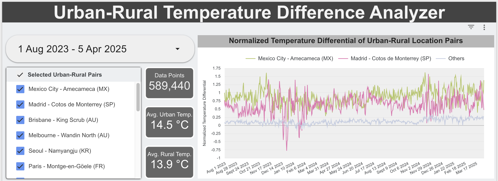

# Data pipeline - with a live dashboard
<a href="https://lookerstudio.google.com/reporting/c9e8d7e9-dab1-467e-93ee-116ec058932c">
  
  <br>
</a>

### [Visit the interactive dashboard by following this link.](https://lookerstudio.google.com/reporting/c9e8d7e9-dab1-467e-93ee-116ec058932c)

## Project Overview

#### A data/ETL pipeline that examines temperature differences between some urban and rural locations that are close to each other. Inspired by the ["urban heat island"](https://en.wikipedia.org/wiki/Urban_heat_island) concept: 

**[An urban heat island occurs when a city experiences much warmer temperatures than nearby rural areas.](https://science.nasa.gov/kids/earth/what-is-an-urban-heat-island/)**

This is a side project which was implemented as a technical exercise.

What does it do?
- Collects historical weather data from a public API
- Processes and examines temperature differentials between urban and rural location pairs
- Runs on a nano-tier machine on EC2 (AWS)
- Visualizes results via Looker Studio, autoupdates daily

## Technologies Used

- **Programming**: Python, SQL, Bash
- **Cloud**: AWS (pipeline, database) & GCP (dashboard)
- **ETL Pipeline**: ETL scripts written in Python, pipeline runs on a nano-tier EC2 instance
- **Scheduled daily pipeline runs**: EventBridge is used to trigger the nano-tier EC2 instance startup/shutdown
- **Database**: PostgreSQL (edit: moved to RDS based PostgreSQL instead of hosting db on EC2 instance)
- **Version Control**: Git
- **Containerization**: Docker (for local development to construct a test database)
- **Visualization**: Looker Studio
- **Data Source**: Open-Meteo API (historical weather data) - https://open-meteo.com
  
## Features

- Interactive selection of urban-rural location pairs
- Time period selection
- Normalized temperature differentials across locations
- Summary statistics including average urban and rural temperatures
- Data points autoupdate daily

## Project Structure

```
urban-rural-temperatures/

├── src/           
│   └── urban_rural_temp/
│       ├── __init__.py    
│       ├── config.py         # Configuration details
│       ├── extract.py        # Data extraction from Open-Meteo
│       ├── initial_load.py   # Load historical data
│       ├── load.py           # Database loading functions
│       ├── daily_pipeline.py # Pipeline scheduled to run daily
│       ├── setup_db.py       # Database setup
│       └── utils.py          # Utility functions
├── docker/            
│   └── docker-compose.yml # container setup for test database
├── sql/                   # SQL definitions
│   ├── schema.sql         # Database schema
│   ├── views.sql          # Materialized views
│   └── indexes.sql        # Database indexes
├── requirements.txt
├── .gitignore
└── README.md          # Project documentation
```


## Analysis

1. **Direct Temperature Differential**: Simple difference between urban and rural temperatures

2. **Normalized Temperature Differential**: An intuitive/practical standardized measure to account for local temperature variability
   - Formula: `Normalized Differential = (urban_temp - rural_temp) / std_dev(rural_temp)`

3. **Calculations over Rolling Window**: The standard deviation of rural temperature is calculated using a 30-day rolling window 

## Ideas for the future
- **Make location pairs more easily configurable**:
  Make it easier to configure which urban-rural location pairs are examined
- **Daily Pattern Analysis**: 
  Examine urban-rural temperature differences by hour of day
- **Seasonal Analysis**:
  Compare how urban-rural temperature differentials change across seasons
- **Document Deployment Steps**:
  Document the steps needed to deploy the pipeline, database and form connection to dashboard
